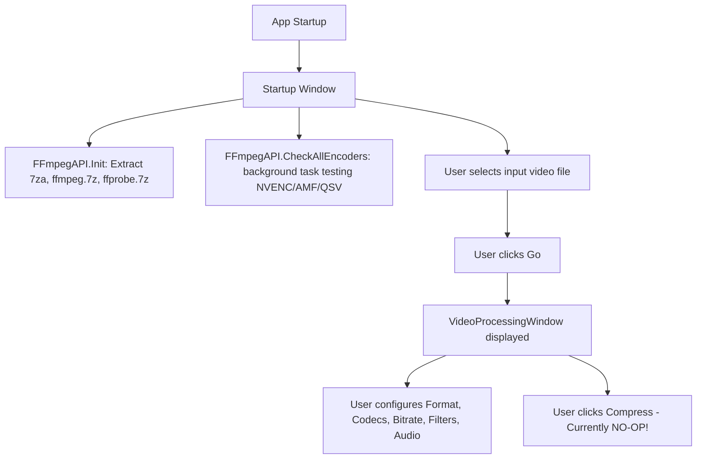

# CS-Compressor Technical Assessment & Architecture Audit

**Target Repository:** [James-dothing/CS-Compressor](https://github.com/James-dothing/CS-Compressor)  
**Date of Audit:** November 2026  
**Auditor:** Autonomous Senior Software Engineer & Open-Source Contributor  

---

## 1. Executive Summary

CS-Compressor is an open-source video compression GUI application built with WPF and targeting .NET 10 (`net10.0-windows`). The project aims to provide a user-friendly interface over FFmpeg for compressing video files, tweaking video and audio codecs, adjusting bitrates, scaling resolutions, and trimming clips.

While the concept and UI scaffolding are ambitious, the application is currently incomplete and suffers from critical operational flaws:
1. **The compression engine is completely unwired**: The "Compress" button in `VideoProcessorWindow.xaml` lacks a click handler and the code-behind contains no execution logic. The application cannot compress any videos in its current state.
2. **Fatal process execution deadlocks**: The synchronous pipe handling in `ProcessAPI.Start` deadlocks when standard output exceeds OS pipe buffer limits.
3. **Application termination on non-fatal errors**: Any error triggered in `MessageBoxAPI.Error` invokes `Application.Current.Shutdown()`, causing the application to abruptly crash rather than presenting recoverable error messages.
4. **Binary extraction catch-22**: On a clean system, extracting `ffmpeg.7z` checks for the presence of `7za.exe` before `7za.exe` has been extracted, triggering a fatal error.
5. **Filter and stream mapping bugs**: The FFmpeg argument builder emits conflicting `-map "0:v:0?"` and `-map "[outv]"` arguments whenever video filters are applied.
6. **Zero automated tests**: The repository contains no unit, integration, or regression tests.

This document details the current architecture, cataloged defects, security and reliability concerns, and the architectural roadmap to bring CS-Compressor to production-ready status.

---

## 2. Current Architecture & Execution Flow

### 2.1 Project Structure
```
CS-Compressor/
├── App.xaml / App.xaml.cs                 # WPF Application entry point
├── Startup.xaml / Startup.xaml.cs         # Initial file selection window
├── VideoProcessorWindow.xaml / .xaml.cs   # Main compression configuration window
├── FFmpegAPI.cs                           # FFmpeg initialization and encoder detection
├── FFmpegArgumentMaker.cs                 # FFmpegArg class: builds command-line arguments
├── ProcessAPI.cs                          # Process launcher using System.Diagnostics.Process
├── ExtractFiles.cs                        # Extracts embedded 7za.exe and 7z archives
├── MessageBoxAPI.cs                       # Dialog wrapper with Application.Shutdown()
├── QOLThings.cs                           # UI helper functions (ComboBox string parsing)
├── frameworks/                            # Embedded binaries (7za.exe, ffmpeg.7z, ffprobe.7z, icon)
├── AssemblyInfo.cs                        # Theme info configuration
└── CsCompressor.csproj                    # Single WPF project targeting net10.0-windows
```

### 2.2 Execution Flow


---

## 3. Detailed Technical Defect Catalog

### 3.1 Critical Functional Defects
1. **Unwired Compression Action (`VideoProcessorWindow.xaml` / `.cs`)**:
   - The primary action button `x:Name="Go"` ("Compress") has no `Click` event handler in XAML and no implementation method in the code-behind.
   - The secondary browse button `x:Name="BrowseButton"` (line 92) also lacks a `Click` handler.
2. **Extraction Catch-22 (`ExtractFiles.cs`)**:
   - `Extract.GetPath("ffmpeg.7z", "ffmpeg.exe")` contains:
     ```csharp
     if (realFileName != "" && !File.Exists(szPath)) {
         MessageBoxAPI.Error("7za.exe doesn't exist");
         return "";
     }
     ```
   - On a clean machine, `7za.exe` does not exist prior to extraction. Calling `GetPath` with `ffmpeg.7z` before `7za.exe` causes immediate failure and application termination.
3. **Filter Mapping Collision (`FFmpegArgumentMaker.cs`)**:
   - Lines 376–379:
     ```csharp
     if (videoFramerate==null||videoResolution==null|| !(accurateColorGif ?? false))
     { result += " -map \"0:v:0?\" -map \"0:a:0?\""; }
     ```
   - If `accurateColorGif` is false (standard video encode), `!(accurateColorGif ?? false)` is always `true`. Thus, `-map "0:v:0?"` is always appended. When resolution or framerate filters are configured, `-map "[outv]"` is also appended. FFmpeg fails or outputs duplicate video tracks.
4. **FFprobe Output String Comparison (`FFmpegArgumentMaker.cs`)**:
   - In `CheckVideoCompatibility` and `CheckAudioCompatibility` for stream copy (`supportedVideoEncoders.copy` / `supportedAudioEncoders.copy`):
     ```csharp
     string[] result = ProcessAPI.Start(ffprobePathArg, ...);
     switch (result[0]) {
         case ("h264"): ...
     }
     ```
   - Standard output from `ffprobe` includes trailing newlines (`\r\n` or `\n`). Because `result[0].Trim()` is not called, `result[0] == "h264"` evaluates to `false`, causing stream-copy checks to always fail.
5. **Cross-Thread UI Access (`FFmpegAPI.cs`)**:
   - In `CheckAllEncoders(VideoProcessingWindow aa)`:
     ```csharp
     await Task.Run(() => { ... });
     aa.UpdateVideoEncoders(availableVideoEncoders);
     ```
   - `UpdateVideoEncoders` mutates WPF ComboBox items directly without `Dispatcher.Invoke`, risking `InvalidOperationException` on thread-affine UI elements.
6. **ComboBox String Parsing Inconsistency (`QOLThings.cs`)**:
   - `QOL.GetStringFromComboBox` assumes items produce `"System.Windows.Controls.ComboBoxItem: <Value>"` and splits on `": "`. When items are added as plain strings (e.g. `VideoEncoderCB.Items.Add(b)`), `.ToString()` does not contain `": "`, resulting in `null`.
7. **Unpopulated Audio Encoders (`VideoProcessorWindow.xaml`)**:
   - `AudioEncoderCB` contains only a static `No encoding` option. Encoders such as AAC, MP3, Opus, FLAC, and Vorbis are never populated.

### 3.2 Reliability & Process Management Issues
1. **Standard I/O Pipe Deadlock (`ProcessAPI.cs`)**:
   - Synchronous invocation of `p.StandardError.ReadToEnd()` followed by `p.StandardOutput.ReadToEnd()` causes deadlocks when the child process writes output exceeding the 4KB–64KB operating system buffer.
2. **Application Crash as Default Error Handling (`MessageBoxAPI.cs`)**:
   - `MessageBoxAPI.Error(text, bool Crash = true)` automatically calls `Application.Current.Shutdown()`. Non-fatal user input mistakes terminate the application.
3. **Resource & Handle Leaks (`ProcessAPI.cs`)**:
   - `Process` instances are neither wrapped in `using` statements nor explicitly disposed.
4. **Zombie Process Accumulation**:
   - No `CancellationToken` or process lifetime management. If the application exits or the user cancels, FFmpeg continues executing indefinitely in the background.
5. **Side-Effects in String Representations (`FFmpegArgumentMaker.cs`)**:
   - `ToString()` writes `LastFFmpegArg.txt` to the file system during argument string formatting.

### 3.3 Security & Input Validation Concerns
1. **Command Line Escaping**:
   - `ProcessAPI.Start` builds commands by concatenating raw strings: `p.StartInfo.Arguments = " " + argument;`. File paths with spaces, quotes, or special characters (`&`, `|`, `^`, `%`) cause syntax failures or argument parsing exploits.
2. **Silent Input Failures**:
   - `Startup.xaml.cs` silently returns when an invalid or empty path is provided without displaying user-facing guidance.

---

## 4. Architectural Target & Improvement Plan

### 4.1 Layered Architecture
To ensure testability and separation of concerns:
```
┌────────────────────────────────────────────────────────┐
│                   CsCompressor (WPF)                   │
│   Startup Window   •   VideoProcessorWindow   •  MVVM  │
└───────────────────────────┬────────────────────────────┘
                            │ depends on
┌───────────────────────────▼────────────────────────────┐
│                  CsCompressor.Core                     │
│  - Services: Locator, Probe, Executor, Progress        │
│  - Models: VideoSpec, AudioSpec, CompressionOptions     │
│  - Builders: FFmpegArgumentBuilder (safe escaping)     │
│  - Validation: Result<T>, ValidationResult             │
└───────────────────────────▲────────────────────────────┘
                            │ tested by
┌───────────────────────────┴────────────────────────────┐
│                  CsCompressor.Tests                    │
│    Argument Tests  •  Validation Tests  •  FFmpeg E2E  │
└────────────────────────────────────────────────────────┘
```

### 4.2 Key Engineering Principles
- **No Unsafe Concat**: Process arguments are constructed with structured escaping.
- **Deadlock-Free I/O**: Asynchronous readers for both `stdout` and `stderr`.
- **Cancellable Operations**: Full `CancellationToken` support with process tree termination (`Kill(entireProcessTree: true)`).
- **Graceful Error Handling**: Non-fatal validation results surfaced via informative UI states rather than process termination.
- **Progress & Telemetry**: Parse frame count, fps, bitrate, current time, percentage, and estimated time remaining (ETA).
- **Platform Resilience**: Automatically detect system-installed FFmpeg before falling back to bundled or user-specified binaries.

---

## 5. Verification & Testing Strategy
- **Baseline Unit Tests**: Test existing argument creation and verify known failure cases.
- **Refactored Unit Tests**: Validate argument combinations across codecs, rate controls, scaling flags, and trimming intervals.
- **Real FFmpeg Integration Tests**: Execute end-to-end video conversions using local FFmpeg and verify resulting files.
- **UI & Error Simulation**: Test edge cases including missing files, invalid bitrates, corrupted input, and user cancellation.
